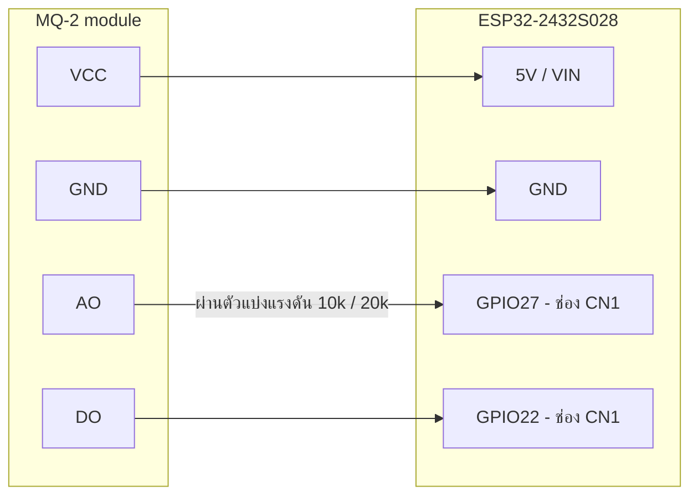

# ESP32-2432S028 (CYD) + MQ-2 Gas Monitor

เครื่องวัดแก๊ส/ควันด้วยเซนเซอร์ MQ-2 แสดงผลบนจอ 2.8" ของบอร์ด ESP32-2432S028 (Cheap Yellow Display)

- แสดงค่าประมาณ LPG และควัน (ppm), แรงดัน AO, Rs/R0
- ป้ายสถานะ SAFE / WARNING / DANGER และกราฟย้อนหลัง
- ไฟ RGB บนบอร์ด: เขียว = ปกติ, เหลือง = เฝ้าระวัง, แดงกะพริบ = อันตราย
- อุ่นเซนเซอร์ 60 วินาที แล้วคาลิเบรต R0 อัตโนมัติ (**ต้องเปิดเครื่องในอากาศสะอาด**)

## การต่อสาย



| MQ-2 | CYD | หมายเหตุ |
|---|---|---|
| VCC | 5V | ฮีตเตอร์ต้องใช้ 5V (กินไฟ ~150 mA) |
| GND | GND | |
| AO | GPIO27 | **ต้องมีตัวแบ่งแรงดัน** AO ขึ้นได้ถึง 5V แต่ ESP32 รับได้แค่ 3.3V |
| DO | GPIO22 | ไม่ต่อก็ได้ ถ้าไม่ต่อให้ตั้ง `MQ2_DO_PIN -1` |

ตัวแบ่งแรงดัน: `AO --[10k]--+--[20k]-- GND` แล้วต่อจุด `+` เข้า GPIO27 (ค่า `DIVIDER_RATIO = 1.5`)

## ตั้งค่า

แก้ใน [include/config.h](include/config.h):

- `DIVIDER_RATIO` — อัตราส่วนตัวแบ่งแรงดัน (ไม่มีตัวแบ่ง = `1.0`)
- `MQ2_RL_KOHM` — ตัวต้านทานโหลดบนโมดูล (ดูตัว SMD: `102` = 1k, `103` = 10k)
- `PPM_WARN`, `PPM_DANGER` — เกณฑ์เตือน
- `WARMUP_SECONDS` — เวลาอุ่นเซนเซอร์

ถ้าบอร์ดเป็นรุ่น 2 พอร์ต USB (micro + Type-C) แล้วจอสีเพี้ยน/ไม่ขึ้น ให้เปลี่ยน `ILI9341_2_DRIVER` เป็น `ST7789_DRIVER` ใน [platformio.ini](platformio.ini)

## Build และอัปโหลด (PlatformIO)

```powershell
pio run -t upload
```

```powershell
pio device monitor
```

## หมายเหตุ

- ค่า ppm เป็น **ค่าประมาณ** จากกราฟใน datasheet ไม่ใช่เครื่องวัดที่สอบเทียบแล้ว ห้ามใช้แทนเครื่องตรวจจับแก๊สเพื่อความปลอดภัย
- เซนเซอร์ใหม่ควรเผา (burn-in) 24 ชม. ก่อน ค่าจะนิ่งขึ้น
- GPIO27 เป็น ADC2 ซึ่งใช้ไม่ได้ตอนเปิด WiFi ถ้าจะเพิ่ม WiFi ภายหลัง ให้ย้าย AO ไป GPIO35 (ช่อง P3) แล้วแก้ `MQ2_AO_PIN`
